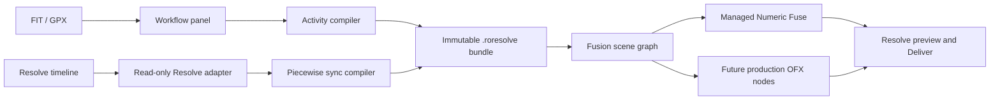

# Running Overlay Resolve Architecture

Last updated: 2026-10-17

## Independence

The Resolve product has no runtime or build dependency on the Swift macOS app.
Cross-product consistency is established through reviewed specifications,
synthetic fixtures, widget semantics, and later visual golden images—not a
shared application target or renderer.

## Components



### Workflow Panel

The sandboxed Electron panel is the asynchronous control plane. It imports and
validates activity data, scans timeline geometry, presents capture-time
evidence, compiles sync segments, and manages the Numeric Fusion node. Only a
narrow preload IPC surface is exposed to the renderer page.

The panel uses a frameless BrowserWindow with a draggable dark header and narrow
minimize/close IPC commands. Renderer close retains the unsaved-change guard.
Calendar and clock/timezone selectors share `src/sync/capture-time.js` with the
Node control plane. Filename recognition returns local date/time components,
not capture UTC authority. Only a complete, reviewed picker value contributes a
user confirmation; the sync compiler still consumes absolute microseconds.

Named IANA zones resolve using the selected date via `Intl` and candidate UTC
round trips. Nonexistent local times are rejected; repeated local times require
an explicit offset. Fixed offsets preserve legacy ISO values. Saved milliseconds
survive untouched date/clock controls. Optional `captureTimeZone`,
`captureTimeZonesByMediaId`, and camera/activity anchor zone fields retain picker
preferences within configuration schema 1; missing fields default safely.
Partial picker drafts stay in the renderer across scans and are not timing
authority. Date/clock/zone edits clear a source's confirmation.

The panel is one state-driven screen: activity, reference-track chips, time
alignment, widgets, and a single primary action whose label follows the state
(scan, choose activity, use file times, set missing times, create, update, up
to date). Edits save automatically after a short debounce; only the primary
action changes Resolve. Silent scans no longer disable form controls, and
polling pauses while the user adjusts timing.

Time alignment infers the recording timezone with
`src/sync/alignment-preview.js` by choosing the zone that places the most
filename clocks inside the activity (the system zone wins ties), shows clips
against the activity on a preview strip, and accepts file or metadata times in
one explicit **Use file times** action. Per-file pickers and camera drift pairs
remain under **Clip details**. The strip is a preview; the sync compiler remains
the only mapping authority.

### Resolve Adapter

The adapter reads one explicit reference video track. It captures stable item
and media IDs, record start/end, source start frame, source frame rate, enabled
state, and media metadata snapshots. It performs no timeline mutation.

It also recognizes a single valid bounded filename timestamp from the original
media path (falling back to the item name). This remains separate from absolute
metadata candidates and confidence evaluation, including after timeline renames.

Resolve metadata is treated as evidence rather than truth. The panel will
eventually add an independent source-file parser for QuickTime/EXIF and camera
telemetry because Resolve does not guarantee recording-time or GPS semantics.

### Sync Compiler

For an ordinary constant-speed segment:

```text
sourceOffsetUs = sourceStartFrame × 1,000,000 × sourceFps.den / sourceFps.num
cameraAtEditIn = captureStartUtcUs + sourceOffsetUs
activityStartUs = cameraClockModel(cameraAtEditIn) - activityStartUtcUs
activityAtFrame = activityStartUs
                + (frame - timelineStartFrame)
                × 1,000,000 × timelineFps.den / timelineFps.num
                × speed
```

The compiler stores the final per-frame rate as a reduced rational. Multiplying
large timing values uses integer/BigInt intermediates; serialized authority
remains JSON-safe integer frames and microseconds.

The result is immutable and piecewise. Cuts may jump forward or backward in
activity time. Gaps have no segment and render transparent.

### Activity Compiler

The independent FIT parser handles ordinary definition/data messages and
compressed timestamp headers for record and timer messages. It reconstructs
five-bit rollover from the last full or compressed timestamp, following the
[Garmin FIT protocol](https://developer.garmin.com/fit/articles/fit-protocol/fit_protocol.html), and rejects a
compressed message without an earlier full time reference. FIT timer events
become real-time pause annotations. A bounded UTF-8 GPX reader imports timed
track points, common numeric extensions, and segment-aware distance and pace.
It requires explicit timezones and rejects DTDs and unknown XML entities. GPX
contains no FIT timer state; track-point gaps do not become pause annotations.
Both parsers normalize to Activity v1. Missing metrics stay null through the
render-data protocol and become an unavailable value in Fusion; interpolation
requires valid values at both adjacent samples.

### Render Bundle

The `.roresolve` directory contains human-readable JSON authority plus compact
tab-separated `.roactivity` and `.rosync` files for the Fuse prototype. It is a
data bundle, not rendered media. Paths in its manifest are relative.

### Fusion And Rendering

The managed Numeric overlay uses one `CT_SourceTool` Fuse for up to four metrics.
It reads immutable activity/sync data, binary-searches the current segment and
activity record, and renders a transparent image for the requested frame.
Heart Rate, Pace, Distance, and Elapsed Time have separate enabled, position,
size, label, font, and color controls. Each Position is a native Point input
with a Fusion viewer crosshair.

`sync.rosync` carries the Resolve timeline start frame. A composition beginning
at that start can use automatic origin mapping; a composition beginning later
must provide its record start as an explicit override. The Fuse accepts the
bundle's adjacent JSON authority paths as user input only to redirect them to
the corresponding renderer data files. Invalid or unreadable protocol data is
rendered as a visible diagnostic. Intentional gaps retain transparent output by
default.

The current managed scene connects the Numeric Fuse directly to MediaOut.
Multiple Numeric Fuses joined by Merge crashed Resolve 21 during composite
rendering, although each node rendered separately. High-cost or
interaction-heavy future widget families can move to OFX without changing the
activity or sync protocols. A future OFX renderer must read the immutable
bundle once per instance and never call Resolve scripting APIs from its render
callback. See [ADR 0008](../../docs/adr/0008-resolve-numeric-widget-renderer.md).

### Data Time Offset

The Fuse's `TimeOffset` input (seconds, Sync page first in the inspector, with
±0.1 s and ±1 s buttons) is added to the activity time after segment lookup:

```text
activityAtFrame' = activityAtFrame + round(TimeOffset × 1,000,000)
```

Positive values show later activity data. An optional sync readout draws the
current activity time and offset in the frame for alignment checks. Once the
overlay exists the Fuse input is authoritative; the panel reads it on scans and
writes it through a small acknowledged Fusion transaction outside the scan
queue, coalescing drags so one write is in flight. A draft offset in the panel
configuration seeds only a newly created renderer. See
[ADR 0009](../../docs/adr/0009-resolve-data-time-offset-in-renderer.md).

`fusion/Templates/Edit/Generators/Running Overlay Numeric (Experimental).setting`
wraps the Fuse as an Edit page generator that publishes the offset and data
inputs. It exists only to verify whether Edit Inspector controls and blade cuts
give per-clip offsets; it is not part of the managed workflow.

## Persisted Versus Derived State

Persisted authority:

- activity file identity and normalized activity data;
- confirmed capture-time evidence;
- manual camera clock anchors;
- widget parameters and scene structure;
- the data time offset, held by the managed Fuse once the overlay exists.

Derived/cache state:

- timeline scan snapshots;
- timeline fingerprint;
- piecewise sync segments;
- renderer-oriented tabular data.

When timeline item geometry changes, its fingerprint changes and derived sync
data must be rebuilt while confirmed anchors remain intact.

## Remaining Host Validation Gates

- Verify Resolve's TimelineItem end-frame convention and source-frame units on
  real media.
- Extend the verified Fusion `req.Time` mapping beyond a 30 fps timeline with a
  01:00:00:00 start to other rates, start codes, and later-starting comps.
- Verify Fuse file access from signed installs and relinked/offline media.
- Validate viewer crosshair behavior on Edit and Fusion pages.
- Verify panel offset writes during Edit page playback, offset save/reopen and
  undo, Edit Inspector exposure through the experimental generator, and
  whether blade-split Fusion clips keep independent offsets and correct time.
  Until then a split or copied managed overlay is detected by marker, or by a
  same-track item with the same source, and blocks updates and panel timing.
- Measure 4K60 performance with at least ten widgets.
- Validate alpha, color management, float image depth, and Deliver output.
- Inspect iPhone, GoPro, DJI, and Insta360 metadata snapshots and direct source
  metadata before expanding automatic confidence rules.

## P1 Control Plane And Managed Composition

`WorkflowService` serializes panel requests, resolves project/timeline identity
from the host, validates saved settings, and rescans before applying. The renderer
page cannot supply an authoritative timeline scan or redirect storage paths.
`ConfigurationStore` writes version-1 settings through a temporary file and atomic
rename under a product-specific Application Support directory. Bundle revisions
are immutable and are not garbage-collected while saved projects may use them.

The service checks Resolve's render state before scanning and applying, and the
composition manager checks again before mutation. A rendering project returns a
paused scan without exporting OTIO or inspecting managed clips. The panel retains
its last snapshot, explains the pause, and disables apply until checks resume.
Polling waits eight seconds after the preceding scan completes. These checks are
best-effort host guards, not an atomic lock against starting a render externally.

The adapter exports temporary OTIO evidence, checks the selected video track,
and removes that raw export afterward. It accepts ordinary external sources and
known visual effects only. Source FPS has no automatic fallback. Resolve 21 OTIO
can truncate a source start to an integer timeline-rate frame (observed for 30 fps
media on 29.97/59.94 timelines); corroboration allows precisely that quantization
interval while the source-frame API and source FPS retain timing authority.
Unsupported mappings never enter the sync compiler. Reference extent excludes
previously generated overlay duration so shortening the edit also shortens its
replacement overlay.

Resolve's direct Fusion-composition insertion has a fixed default duration. The
manager therefore imports an authored OTIO timeline containing a generated
transparent still at the required duration, creates a Fusion carrier, places it
on a dedicated video track, and removes the temporary setup timeline. The
Numeric Fuse feeds MediaOut directly; the still is not the graphics renderer. The manager
uses a custom-data marker to identify its clip. A range change prepares a new
clip and imports the previous composition before removing only the old owned
clip. Failed preparation removes the new candidate and keeps the old clip.

The native Workflow bridge does not expose usable Fusion Tool objects from
`GetToolList`, and reports a parse error for void results. Node creation, input
updates, rollback, and a single Fusion undo transaction therefore execute as a
bounded Lua operation inside the composition. Values use delimiter-safe Lua
literals, never interpolated executable expressions. The panel waits for a unique
scalar acknowledgment through `GetData`; an old acknowledgment cannot report a
new operation as successful. The known void/nil-result bridge error is handled
only where the transaction acknowledgment verifies the outcome.

An explicit `AutomaticOrigin` input keeps older manual compositions compatible
while allowing managed clips to specify frame zero without the old sentinel
ambiguity. Rendering continues to consume only immutable activity/sync files.

See [ADR 0007](../../docs/adr/0007-resolve-managed-overlay-workflow.md) for the
persistence, ownership, and timeline-undo boundaries.
