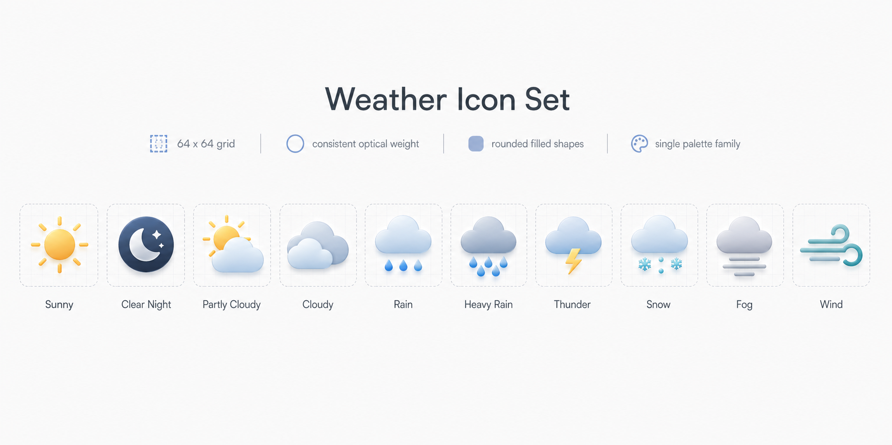

# Weather Widget Overlay UI Design Spec

Last updated: 2026-11-09

## Purpose

Weather Widget Overlay is a simple weather-app-style overlay for showing the day-of-run weather context on exported running videos. It should feel like a compact weather app plugin rather than a sport-specific performance module.

The visual implementation and API fetch pass are in place. The component renders a single weather-app-style card plus a shared SwiftUI weather icon family, and it caches historical weather from the activity GPS location. Open-Meteo remains the default no-key provider; OpenWeather is available when an API key is configured in Project Settings.

When a Weather Widget is first added, it starts from activity-location
API data rather than baked-in sample content. If the current activity
has a GPS route, the app automatically fetches historical weather for the
activity start point. Until that request succeeds, or when no route/API data is
available, the widget renders a neutral Sunny condition/icon while data fields
such as location, temperature, humidity, and wind render `--` placeholders.

## Design References

## User Goals

- Show the current weather condition and temperature clearly.
- Include location and country after weather data or a manual location is available.
- Keep weather icons visually consistent at every card scale.
- Allow future data to come from FIT temperature, a weather API, or manual fallback values.

## Content Model

Required display fields:

- `condition`: weather state label, e.g. `Rain`. Every field is user-overridable; manual edits take precedence over default labels.
- `temperature`: current temperature, e.g. `13°C`, or `--` when weather data is unavailable. Unit defaults to system locale (°C or °F), user-adjustable per widget.

Optional display fields:

- `location`: city and country/region, or `--` when no location has been selected or resolved.
- `weekday`: English weekday, e.g. `Thursday`.
- `humidity`: relative humidity, e.g. `87% RH`.
- `highTemperature`: daily high, e.g. `H 16°`.
- `lowTemperature`: daily low, e.g. `L 11°`.
- `wind`: wind speed, e.g. `9 km/h`.
- `feelsLike`: apparent temperature, e.g. `Feels 12°C`. In the card's inline metric row, the value must include the `Feels` label so it is not confused with the current temperature.

## Card

Medium rounded rectangle inspired by a clear weather app widget.

Layout:

- Left block: large condition label, e.g. `Rain`, plus a large weather icon.
- Center divider: thin vertical rule. The left block should stay compact so the divider sits close to the icon group rather than leaving a large empty column.
- Right block: location placeholder/data, weekday, large temperature placeholder/data, humidity.

Default size target: `300 x 110`.

This is the only card template: it communicates weather and location with the
least explanation. Alternative presentations should ship as separate components.

## Icon System

All weather icons must come from one visual family.

Rules:

- Use a `64 x 64` icon grid as the base design box.
- Keep consistent optical weight across icons.
- Prefer rounded filled shapes with a subtle shared highlight/shadow treatment.
- Avoid mixing outline-only, emoji-like, realistic, and cartoon icon styles.
- Use one coherent palette family:
  - Sunny: warm yellow/orange.
  - Clear night: navy plus pale moon.
  - Cloud states: cool cyan/blue-gray.
  - Rain/heavy rain: blue.
  - Thunder: cloud blue plus yellow lightning.
  - Snow: icy cyan.
  - Fog: gray-blue.
  - Wind: teal-gray.
- Icons should scale cleanly to `20`, `32`, `48`, and `64` px without changing style.

Initial conditions to cover:

- Sunny
- Clear Night
- Partly Cloudy
- Cloudy
- Rain
- Heavy Rain
- Thunder
- Snow
- Fog
- Wind

Implementation assets:

- Weather Widget now ships transparent `512 x 512` PNG assets under `Sources/RunningOverlay/Resources/Icons/`.
- File names are `weather-sunny.png`, `weather-clear-night.png`, `weather-partly-cloudy.png`, `weather-cloudy.png`, `weather-rain.png`, `weather-heavy-rain.png`, `weather-thunder.png`, `weather-snow.png`, `weather-fog.png`, and `weather-wind.png`.
- The component resolves icons through `WeatherCondition.bundledImageName` and `IconView(asset: .bundledImage(...))`.
- `weather-icon-set.png` remains the design board/reference; PNG files are the production assets used by the widget.

## Visual Rules

- Do not make the weather widget feel like a running metric by default.
- The card must have a clear location slot.
- Text must remain readable on video; use subtle shadow or translucent backing when needed.
- Avoid decorative background blobs or purely atmospheric graphics.
- Keep cards practical: stable dimensions, predictable alignment, no nested card structures.
- Use 8-18 px corner radii for the card.
- Prefer blue, white, graphite, and pale sky surfaces with weather-specific accents.
- Avoid purple-heavy palettes.

## Data Strategy

Phase 1 can be manual/activity-first:

- Current temperature may read from FIT temperature when available.
- If FIT temperature is absent, use manual temperature.
- Condition, high/low, humidity, wind, and feels-like values can be manual fields.

API support:

- Query historical weather for the activity date (Open-Meteo archive API), not current forecast. Running data is always past events; a forecast is meaningless.
- Optionally query the OpenWeather One Call 4.0 one-hour timeline when the overlay data source is OpenWeather API and the Project Settings Weather section has an API key.
- Use the first GPS route point from the activity for explicit weather fetches.
- Auto-localize condition labels from activity coordinates (e.g. Japan → Japanese labels), not from system locale. All fields remain user-editable.
- Cache resolved weather data in the project to make export deterministic.
- Keep API failures non-destructive by falling back to manual fields.

## Inspector Guidance

Recommended sections:

- Layout
- Effects
- Component
- Weather
- Weather Data, Visibility, Labels, Card, Slots, Text, Location Text,
  Condition Text, Temperature Text, Slot Title Text and Slot Label Text,
  generated from the component definition

Key controls:

- Location fetch action: activity GPS start location.
- Location text fields.
- Data source picker (Manual, Open-Meteo API, OpenWeather API) lives in the Weather section.
- When the loaded activity includes temperature records, Weather exposes a **From Activity** checkbox (tooltip: "Use the temperature recorded in the activity"). When enabled, activity temperature overrides the API or manual temperature at the current playhead for more accurate on-run readings.
- Manual mode: condition picker, optional label override, manual temperature, unit, Style-specific metric slots, and manual values for selected slot metrics.
- API modes: API-owned condition/temperature/metric text inputs are hidden; keep unit, Style-specific metric slot assignment, display toggles, and optional FIT temperature override. OpenWeather mode disables fetch buttons until an OpenWeather API key is set in Project Settings.
- The card has one inline metric slot. It can choose `-`, Humidity, High / Low, Wind, or Feels Like. `-` leaves the slot empty.
- Toggles for weekday, condition label, and icon visibility.
- Collapsed Weather Widget Inspector sections use the regular single bottom header separator so adjacent rows read as one thin divider, not doubled rules.

Weather Widget 1.0 intentionally does not expose the shared overlay Background or Border modules. Those controls do not affect the custom SwiftUI weather card renderer, so the Inspector should keep customization inside the widget's own supported surface. The host Effects module stays available because it applies shadow, glow and opacity around the whole component.

## Implementation Notes

- Treat this as a dedicated overlay type rather than a numeric temperature variant. It combines icon, condition, location, and optional weather metrics.
- The icon set should be implemented once and reused by every weather component.
- Preview and export must share the same render layout.
- API-backed weather must be cached before export so videos are reproducible offline.
- Fetching weather from Inspector actions must be explicit and reversible: successful fetches write `cachedWeather`, keep the selected API source, and update the visible location from reverse geocoding. The initial fetch on newly added widgets is automatic and does not create a separate undo step.

## Current Implementation

Implemented as of 2026-05-07:

- Dedicated Weather Widget overlay model with one Simple Card template.
- Shared SwiftUI weather icon family using custom shapes instead of SF Symbols in the main preview/export path.
- Production weather icons are now bundled transparent PNG assets resolved from `WeatherCondition.bundledImageName`, preserving the same visual family while making the icons reusable outside the Weather Widget view code.
- Newly added widgets start with Open-Meteo selected, no sample city text, and placeholder weather fields until activity-location weather is cached.
- Inspector orders the primary setup sections as Layout, Effects, Component, then Weather.
- Inspector combines Content, Temperature, Metrics, and Icon into one Weather section.
- Inspector hides API-owned manual input fields when an API source is selected, while keeping unit/display toggles available.
- Inspector replaces the old Humidity / High-Low / Wind / Feels Like toggles with one inline metric slot that chooses one of those four values. `-` leaves the slot empty.
- Inspector exposes condition label override in manual/FIT mode, palette selection in Card, and editable divider visibility/color/width/opacity.
- Inspector removes Icon Size from the user-facing 1.0 controls and adds a Show Icon toggle.
- Inspector exposes one API fetch button in Location for the first activity GPS point.
- The supported styling surface is limited to palette, card opacity, corner radius, dividers, icon visibility, and field visibility.
- The card tightens its left visual block so the vertical divider no longer floats in an empty center column.
- Show Divider hides the divider line while preserving the user's divider color, width, and opacity settings for later reuse.
- Metric slot menus include `-`; an empty slot does not render any metric content.
- Feels Like renders as `Feels 12°C` in the inline metric row.
- Open-Meteo historical fetcher parses hourly temperature, humidity, apparent temperature, WMO weather code, and wind speed; the chosen hour follows the activity start time.
- OpenWeather historical fetcher uses the One Call 4.0 one-hour timeline with metric units; timestamp responses provide condition, temperature, humidity, wind, and feels-like values.
- OpenWeather authorization failures tell the user that a new key or subscription may still be activating, ask them to enable One Call 4.0, note that the first 1,000 calls per day are free, and suggest Open-Meteo as the no-key fallback.
- FIT/manual temperature resolution, explicit `°C` / `°F` formatting, and API cache usage only when the data source is an API provider.
- Optional cached metrics still respect the widget visibility toggles.

Remaining:

- Fully localized condition labels from coordinates beyond the current location-text heuristic.

## Resolved Decisions

- **Condition label localization**: Auto-localized from activity coordinates (FIT GPS), not system locale. Every display field is user-editable; manual values override auto-localized ones.
- **Temperature unit default**: Follows system locale (°C or °F), with a per-widget override in Inspector.
- **API weather data**: Always historical weather for the activity date. Open-Meteo archive API is the no-key default; the OpenWeather One Call 4.0 one-hour timeline is optional when a key is configured. Running is always a past event; forecasts are not meaningful.
