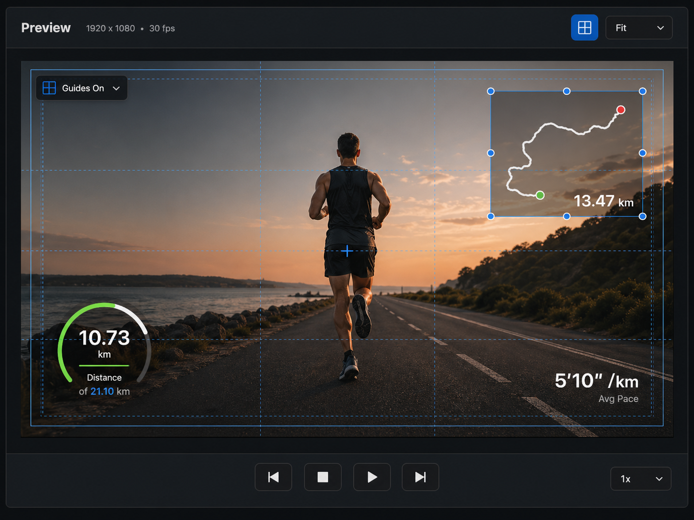

# Preview UI Design Spec

Last updated: 2026-11-05

## Purpose

The Preview is the central editing surface for video playback and overlay placement. It should own preview-specific controls, including the safe guides toggle. The safe guides control should no longer live beside Export in the app-level toolbar.

This spec is implementation-facing. Use it to update `PreviewCanvasView` and the main toolbar interaction split.

## Design Reference

## Scope

This design covers the middle Preview panel only:

- Preview title and project display metadata.
- In-preview safe guides control.
- Fit Mode pop-up.
- Video canvas and overlay editing affordances.
- Single-row playback controls.

Explicitly out of scope for this Preview revision:

- Preview timeline scrubber.
- Playback timecode text.
- Fullscreen control.
- Background/checker toggle.
- Overlay visibility toggle.
- Export actions.

## Current Implementation Mapping

Current SwiftUI entry points:

- `Sources/RunningOverlay/UI/PreviewCanvasView.swift`
- `Sources/RunningOverlay/UI/MainEditorView.swift`

Current behavior to migrate:

- `project.showPreviewGuides` is currently toggled from `MainEditorView.toolbar`, beside Export.
- Move that toggle into the Preview panel header.
- Keep Export as an app-level action in the main toolbar.

Existing behavior to preserve:

- Video preview playback.
- Media-pool source preview vs timeline playhead preview behavior.
- Overlay rendering on the fitted canvas.
- Overlay selection by clicking elements.
- Overlay dragging with normalized canvas coordinates.
- Clearing media-pool preview and selection when clicking empty canvas.
- Safe guide rendering through `PreviewSafetyGuidesView`.
- Existing playback actions: previous clip, play/pause, next clip, and playback rate.

## Layout

Top to bottom:

1. Preview header
2. Canvas workspace
3. Bottom playback row

The Preview panel should use app-level dark editor styling from [App UI Design System](../../system/app-ui.md).

### Preview Header

Left side:

- Title: `Preview`
- Metadata: `1920 x 1080 • 30 fps`

Right side:

- Safe Frames toggle button, on when `project.showPreviewGuides == true`
- Canvas background color well
- Fit Mode pop-up showing `Fit` or `Fill`

No other controls in this revision.

Header rules:

- Height: 44-52 px.
- Background: `panel.header` or `app.chrome`.
- Bottom border: `border.subtle`.
- Safe Frames is a `Toggle` with `.toggleStyle(.button)`, so accessibility
  reports its on/off state. The on state uses `accent.blue` foreground and
  `accent.blue.soft` background. Header icon buttons show a hover fill.
- Safe Frames is also available as the checked View > Show Safe Frames (⌘')
  menu item.
- Fit Mode is a regular-size system pop-up (`Picker` with `.menu` style),
  with room for the selected value and indicator. It offers only Fit
  and Fill; there are no zoom levels.

Implementation notes:

- Resolution should come from `project.settings.resolution`.
- Frame rate should come from project settings or export/preview settings if available. If no model-backed frame rate is available, show only resolution until frame rate exists.
- Fit Mode is view state on `ProjectDocument` (`previewFitMode`) and is not saved in the project file.

### Canvas Workspace

The canvas workspace is the dark region that centers the fitted project-resolution video frame.

Rules:

- The fitted canvas remains 16:9 or the selected project aspect ratio.
- Canvas should stay centered in available space.
- Use `app.bg` or `app.chrome` around the frame.
- Empty video state remains inside the canvas area. It shows `No Video` and
  one hint line: import videos when the project has none, or move the playhead
  over a clip when no clip covers it. There is no icon.
- Overlays render and interact in project-canvas coordinates, not outer panel coordinates.

Safe guides:

- When enabled, draw guide overlays on top of video and below the overlay selection border.
- Include safe-area rectangles and center guides.
- Guides should be thin, subtle, and non-interactive.
- Use blue/cyan with low opacity. Do not make guides look decorative.

There is no canvas HUD for guides; the Safe Frames toggle state is enough.

Overlay editing affordances:

- Selected overlay gets a subtle blue selection border with a 1pt dark outer
  stroke, so it stays visible on bright video. There are no corner handles;
  scale is edited from the Inspector.
- Pointer: hovering a movable overlay shows the open hand; dragging shows the
  closed hand. A locked overlay keeps the arrow, shows a `Locked` help tag, and
  clicking it briefly shows a lock mark at the overlay's top-right corner.
- Non-selected overlays show no selection border.
- Dragging an overlay should support pixel-threshold snapping on the fitted canvas:
  - When safe guides are enabled, overlay left/right edges snap to the 90%/80% vertical safe-guide lines, top/bottom edges snap to the 90%/80% horizontal safe-guide lines, and overlay center axes snap to the canvas center crosshair.
  - Visible overlays snap to each other by left/center/right and top/center/bottom alignment lines, regardless of safe-guide visibility.
  - The snap threshold is canvas-pixel based so behavior is stable across project resolutions and split-pane sizes.
  - Active snap lines should render only during drag, above guide overlays and below/around interactive overlays, and should not intercept hit testing.
  - Holding Command while dragging bypasses snapping: the overlay follows the pointer freely (still clamped to the canvas) and no snap lines render. The modifier is read on every drag update, so pressing or releasing it mid-drag takes effect immediately.

### Bottom Playback Row

The Preview bottom area is a single row.

Centered playback cluster:

- Previous Clip
- Play/Pause
- Next Clip

There is no Stop button; Pause already stops playback without moving the
playhead. Previous Clip and Next Clip jump to the previous or next timeline clip
start, or to the previous or next media-pool item while one is previewed.

Bottom-right speed control:

- Regular-size system pop-up (`Picker` with `.menu` style) showing the
  current playback rate, for example `1x`.
- Options: 0.5x, 1x, 2x, 4x, 8x.

Do not show:

- Timecode.
- Playback time text.
- Scrubber/progress bar.
- Preview-local timeline.

Rules:

- Row height: 44-52 px.
- Playback cluster is visually centered in the panel, independent of the speed control.
- Speed control is pinned to the right with panel padding.
- Buttons use the shared icon-button style.
- Play/Pause can be slightly emphasized, but should stay compact.

## Interaction Rules

- Safe guides button toggles `project.showPreviewGuides`.
- Fit Mode switches the video between aspect fit and aspect fill.
- Previous Clip / Play-Pause / Next Clip call the existing playback commands.
- Speed control calls `ProjectDocument.setPlaybackRate`. `L` doubles up to 8x;
  `J` halves down to 1x and pauses at 1x or below.
- Clicking empty canvas clears overlay selection and clears media-pool preview, preserving current behavior.
- Clicking an overlay selects it and opens the Inspector detail state.
- Dragging an overlay updates normalized position and commits undo grouping at drag end.
- Dragging an overlay first computes a proposed normalized center point, then applies preview snapping before updating local live-drag state.
- Preview snapping uses measured rendered overlay frames in canvas coordinates, not hard-coded overlay type dimensions.
- Overlays with visibility off are not rendered in the Preview canvas.
- Locked overlays are rendered but cannot be selected or dragged from the Preview canvas. Clicking one shows the lock mark described above.
- Right-clicking a Preview overlay opens the same context menu as Inspector rows (`Duplicate`, `Copy Properties`, `Paste Properties`, `Hide`/`Show`, `Lock`/`Unlock`, and `Delete`); paste follows the same category-compatibility rules. Hidden overlays are not on the canvas, so they are shown again from the Inspector row.

## Component Guidance

Recommended components:

- `PreviewPanel`
- `PreviewHeader`
- `PreviewMetadataLabel`
- `PreviewSafeGuidesButton`
- `PreviewFitMenu`
- `PreviewCanvasWorkspace`
- `PreviewPlaybackBar`
- `PreviewPlaybackButton`
- `PreviewRateMenu`

Use shared app components where available:

- `EditorIconButton`
- `EditorPanelHeader`
- `EditorStatusPill`

## App Toolbar Change

Remove the safe guides toggle from the app-level toolbar in `MainEditorView`.

App toolbar should keep:

- Activity import.
- Video import.
- Export progress.
- Export action.

Preview-specific controls should live in the Preview panel.

## Accessibility

- Safe Frames toggle is labeled `Safe Frames`; its help reads `Show Safe Frames`
  or `Hide Safe Frames`.
- Fit pop-up is labeled and helped as `Fit Mode`.
- Playback buttons need labels: Previous Clip, Play, Pause, Next Clip.
- Speed control needs label: `Playback Speed`.
- Guide lines should not interfere with hit testing.
