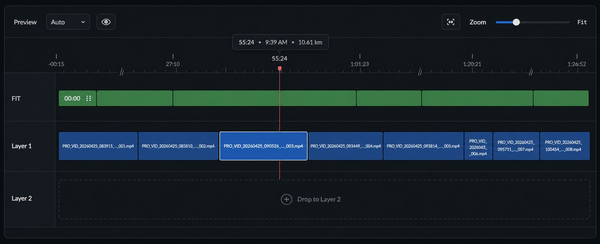

# Timeline UI Design Spec

Last updated: 2026-11-05

## Purpose

The Timeline is the bottom editing surface for video/FIT alignment, playback position, clip selection, clip movement, zoom, preview-track selection, and collapsed gap viewing. It should feel like a precise professional editor timeline while preserving the app's FIT-specific alignment model.

This spec is implementation-facing. Use it to refine `TimelineView` and `TimelineCanvasNSView`.

## Design Reference

## Scope

This design covers:

- Timeline header controls.
- Timeline ruler.
- Fixed label column.
- Activity data layer.
- Video layers and clip blocks.
- Playhead.
- Drag/drop targets.
- Zoom and collapsed gap behavior.

Future features such as trim handles, snapping, markers, and waveforms are out of scope unless separately specified.

## Current Implementation Mapping

Current SwiftUI/AppKit entry points:

- `Sources/RunningOverlay/UI/TimelineView.swift`
- `Sources/RunningOverlay/UI/TimelineInteraction.swift` (key, selection,
  pointer, and header-readout rules as testable functions)
- `Sources/RunningOverlay/Timeline/TimelineModel.swift`

Existing behavior to preserve:

- Implicit preview track selection (`Auto`).
- `Preview Layers` pull-down and per-layer eye toggles for preview visibility.
- Collapse toggle for hiding gaps without video, mirrored by a checked
  Timeline menu item.
- Zoom slider with nonlinear mapping, zoom buttons, a visible-duration readout,
  and a `Fit` button.
- Ruler seeking and hover data.
- `C`-held hover scrubbing that moves the playhead to the hovered timeline time without clicking.
- Activity layer shown independently above video tracks.
- Video clips can be dragged horizontally in expanded mode.
- Collapsed mode hides no-video gaps and disables horizontal dragging of existing video clips.
- Red playhead spans visible timeline tracks and stays visible during playback.
- Media drag/drop creates or moves clips and exposes one new-layer target.
- Empty project shows no fake playhead, Activity layer, or track.
- Activity/media-ready empty timeline shows a default `Layer 1` drop lane.

## Layout

Top to bottom:

1. Timeline header.
2. Ruler.
3. Activity track, when activity data exists.
4. Video layers.
5. Optional drop target lane during media drag.

Startup sizing:

- The app should start with a compact timeline height so the Media Pool,
  Preview, and Inspector get more vertical space.
- Default timeline split height is about 110 pt, with a 96 pt minimum; users can
  drag the split taller when they need to inspect more tracks.

Left to right:

1. Fixed label column.
2. Scrollable time lane area.

## Header

Left controls:

- `Preview Layers` pull-down with a visible menu indicator and an `eye` icon.
  It lists one checked item per layer. When some layers are excluded from the
  preview, the icon becomes `eye.slash` and the title adds a count, e.g.
  `Preview Layers  1 of 2`.

The previous explicit `Auto` preview-track picker was removed; preview track
auto-selection is implicit. Each layer label also has its own eye toggle (see
Label Column), so the pull-down is the batch entry point.

Right controls:

- Collapse-gaps toggle: `Toggle` with `.toggleStyle(.button)` and the fixed
  `arrow.left.and.right.square` symbol. The system on state shows when gaps are
  hidden; the symbol never switches between filled and outlined.
- `minus.magnifyingglass` button (Command-Minus), zoom slider,
  `plus.magnifyingglass` button (Command-Plus).
- Readout of the time visible at the current zoom, e.g. `30 s`, `2 min`,
  `1.5 h`. It never shows raw pixels per second.
- `Fit` button (Shift-Z toggles Fit), disabled while already at Fit.

Rules:

- Do not add a separate `Gaps hidden` row, status band, or extra text row.
- The Timeline menu's `Hide Gaps Without Video` item is checked when gaps are
  hidden. It and the header toggle set the same `ProjectDocument` state.
- Do not show the playhead time or a timecode anywhere; the timeline is for
  alignment.
- Header height follows app-level panel header sizing.

## Ruler

The ruler communicates project display time, including pre-activity and post-activity spans.

Requirements:

- Support negative pre-start labels such as `-00:15`.
- Support activity labels such as `27:10`, `55:24`, `1:01:23`.
- Support post-finish labels such as `1:20:21`, `1:26:52`.
- Ticks should be subtle and evenly aligned to the time scale.
- Hover data appears as a compact pill tooltip, e.g. `55:24 • 9:39 AM • 10.61 km`.
  The text is 11 pt and the pill sizes to its text, capped at the canvas width.
- The pill floats above the ruler, rendered as a SwiftUI overlay on the canvas with a negative y-offset so it visually overlaps the panel header below its bottom edge. No vertical space is reserved inside the ruler for the pill.
- The hover pill has a small downward-pointing arrow on its bottom edge whose tip aligns with the hovered ruler position, so the pill reads as a tooltip pointing down to the time scale without sitting under the cursor.
- The ruler height is `rulerScaleHeight` only (28 pt). There is no `rulerHoverHeight` padding.

## Label Column

The label column is fixed while the time lanes scroll.

Labels:

- `Activity`
- `Layer 1`
- `Layer 2`
- Additional layer names from timeline tracks.

Rules:

- Use a slightly different background from lane area.
- Separate from lanes with a vertical divider.
- Keep labels compact and readable.
- Highlight a drop target label subtly during drag-over.
- Each layer label ends with an eye toggle (`eye` / `eye.slash`) that includes
  or excludes the layer from the preview. Excluded layers draw their name and
  clips dimmed.
- The column is 84 pt wide so a name such as `Camera A` fits beside the eye.

## Activity Track

The Activity track represents the activity data layer (labelled `Activity`; the
older name `FIT` remains in some code identifiers such as `drawFitTrack`).

Visual:

- Green bar spanning activity duration for steady activities.
- Interval workouts use lap-kind colors on the FIT bar: WU, RUN, REST, CD, and unknown laps map to distinct phase colors sourced from `LapRecord.kind`.
- Timer-paused spans overlay the FIT bar in muted gray above steady or interval phase colors, but remain below the FIT track outer border so their visual height matches adjacent phase blocks.
- Start block or label near the beginning, e.g. `00:00`.
- Dark block borders consistent with clip splice edges.

Behavior:

- The Activity layer is not draggable in the timeline UI; clicking it does
  nothing. Activity alignment is changed elsewhere, not by dragging this track.
- Hovering a gray pause span shows `Timer Paused` with the pause elapsed range and duration.
- Hovering an interval phase span shows the English lap kind, lap number, elapsed range, and duration.
- The design should read as the activity axis, not a normal video clip.
- In collapsed mode, FIT-only regions without video may be hidden according to current model behavior.
- In collapsed mode, video-only regions outside the activity range must not draw an Activity block.
- FIT track span colors are lap-kind driven for intervals and annotation-overridden for pause spans, without changing timeline alignment semantics.

## Video Tracks And Clips

Clip visual:

- Blue blocks on dark track bands.
- Width is proportional to actual duration at current zoom, including Fit view.
- Adjacent internal clip edges are square, with dark splice borders.
- Avoid pill-shaped adjacent clips.
- Clip labels are clipped or middle-truncated inside blocks.
- Hide labels if a clip is too narrow.

Selection:

- Selected clip uses a crisp 2 px white border around the clip block.
- Multiple clips selected by a marquee or modifier clicks each use the same crisp white border.
- Selection border should not overpower the clip fill or playhead.

Track background:

- Alternating dark bands.
- Thin horizontal separators.
- Clear lane boundaries without heavy grid lines.

## Playhead

The playhead must be visible but not visually aggressive.

Visual:

- Full-height vertical line in muted red/coral, starting from inside the ruler band and extending down through all visible tracks.
- Small downward-pointing triangle at the top, sitting inside the ruler band so the playhead does not extend above the ruler.
- The triangle's tip connects directly to the vertical line so the marker reads as one continuous cursor.
- Use `#E4525A` or similarly muted red, with lower opacity on the line where appropriate.

Rules:

- Do not use a large bright red arrowhead.
- Do not let the playhead head/line stick out above the top of the ruler.
- Do not use a square or rectangular block as the marker; use a downward triangle.
- The playhead should read as an editing cursor, not a warning marker.

## Collapsed Gap Mode

Collapsed mode hides gaps without video.

Visual:

- Communicate collapsed state through the header icon active state.
- Do not allocate a separate status row.
- Clip blocks may appear joined back-to-back with dark splice borders.
- Optional compressed-gap markers should be subtle and only used if they clarify display-time discontinuity.

Interaction:

- Playback skips hidden empty regions.
- Existing clips cannot be dragged horizontally in collapsed mode.
- Users should expand the timeline before timing edits that need full time context.

## Drag And Drop

Media drag-over state:

- Highlight the target layer lane.
- Expose exactly one new-layer target beyond existing layers.
- Use a subtle dashed outline or translucent fill.
- Label may read `Drop to Layer 2` or `New Layer`.

Rules:

- Drop target should not look like a real clip before drop.
- Drag feedback should not obscure the playhead or existing clips.

## Interaction Rules

- Ruler click/drag seeks the playhead immediately, including during playback; playback continues from the new position.
- Holding `C` while moving the mouse over the timeline time area scrubs the playhead to the hovered time, matching DaVinci-style hover scrubbing. The timeline consumes `C` key-down/key-up events while the mouse is over the timeline and no text input has focus, so macOS does not play invalid-key feedback during hover scrub.
- Clip click selects the clip. Command-click adds or removes a clip.
  Shift-click selects the clips between the last clicked clip and this one on
  the same layer; on another layer it starts a new selection. Command-A (Edit >
  Select All) selects every clip while the timeline has focus. All of these go
  through `ProjectDocument.selectClips`.
- Dragging from empty timeline time-area space, including below the final video lane, draws a translucent blue marquee with a dashed blue edge; every clip intersecting the marquee is selected across layers.
- Releasing a marquee commits the multi-selection. Delete and Forward Delete remove all selected clips in one undoable edit.
- Expanded-mode clip drag changes effective start time.
- Collapsed-mode clip drag is disabled, but selection still works.
- Command-scroll and pinch zoom the timeline continuously around the pointer: the time under the pointer stays in place. Mouse-wheel notches zoom one step each.
- Pointer: open hand over clips in expanded mode and closed hand while
  dragging; in collapsed mode, `operationNotAllowed` with the help text
  `Show gaps to move clips`. Left-right resize pointer over the ruler and within
  3 pt of the playhead line, which can be grabbed and dragged anywhere below
  the ruler.
- Clip context menu holds clip commands only: `Apply Offset to Layer` (single
  clip; the offset value is in its help text), `Reset Offset` / `Reset
  Offsets`, separator, `Delete Clip` / `Delete N Clips` showing the Delete key.
  Right-clicking a clip that is already selected keeps the selection and the
  menu acts on every selected clip; otherwise the clicked clip becomes the
  selection. Resetting several offsets is one undo step.
- Layer context menu: right-clicking a layer label or an empty part of a lane
  offers only `Delete <layer>…`, which confirms in a sheet before removing the
  layer (undoable).
- Menu, keyboard, and slider zoom changes keep the playhead visible and recenter on it.
- During playback, the timeline scrolls to keep the playhead visible.
- Delete and Forward Delete remove selected timeline clips when the canvas has
  focus. The canvas claims them in `performKeyEquivalent` and implements
  `delete:` so no menu key equivalent can intercept them first.
- Holding `C` never takes the key from a focused text field; hover scrubbing
  only runs while no text input has focus.

## Component Guidance

Recommended components:

- `TimelinePanel`
- `TimelineHeader`
- `TimelinePreviewTrackPicker`
- `TimelineTrackVisibilityMenu`
- `TimelineCollapseButton`
- `TimelineZoomControl`
- `TimelineRuler`
- `TimelineLabelColumn`
- `TimelineFitTrack`
- `TimelineClipBlock`
- `TimelinePlayhead`
- `TimelineDropTarget`
- `TimelineHoverInfoPill`

Rendering can remain AppKit-based for precision. Apply the shared `EditorTheme` colors and measurements consistently in drawing code.

## Accessibility

- Header controls need labels and `.help(...)`.
- Collapse button help should switch between `Hide gaps without video` and `Show timeline gaps`.
- The canvas is an accessibility group labelled `Timeline`. Its children are
  one group per layer (e.g. `Layer 1, 3 clips`) followed by the playhead.
- Each clip is a pressable, selectable element that reads its name, start
  (activity elapsed time) and duration; pressing it selects the clip.
- The playhead is a slider whose increment and decrement step one frame.
- Activity segments are not exposed yet.
- Timeline canvas should become first responder on click so shortcuts are delivered correctly.
